[简体中文](./README.md) · [Website](https://zerorun.lei6393.com) · [GitHub](https://github.com/SuperMarioYL/zerorun)

<picture>
  <source media="(max-width: 600px) and (prefers-color-scheme: dark)" srcset="./assets/presentation/hero-mobile-dark.svg">
  <source media="(max-width: 600px)" srcset="./assets/presentation/hero-mobile-light.svg">
  <source media="(prefers-color-scheme: dark)" srcset="./assets/presentation/hero-dark.svg">
  
</picture>

# zerorun

**Inspect a model launch plan before running it.**

ZeroRun compares GPU metadata with a versioned configuration registry, ranks feasible variants by a declared heuristic, and exposes the selected launch arguments.

## Why use it

A model launch requires choosing a weight format, backend and matching arguments. Keeping those choices in a registry makes the decision inspectable and gives a dry-run path before a download or launch.

- **Explain feasibility** — Rejected variants include their requirement shortfall.
- **Version the configuration** — Model and backend choices live in YAML.
- **Inspect before launch** — Dry-run exposes the plan without starting inference.

## Architecture

<picture>
  <source media="(max-width: 600px) and (prefers-color-scheme: dark)" srcset="./assets/presentation/architecture-mobile-dark.svg">
  <source media="(max-width: 600px)" srcset="./assets/presentation/architecture-mobile-light.svg">
  <source media="(prefers-color-scheme: dark)" srcset="./assets/presentation/architecture-dark.svg">
  
</picture>

The probe obtains GPU data or uses an explicit simulation. Registry loaders validate entries; picker tests configured VRAM and compute-capability floors and ranks candidates. The launcher constructs backend arguments and can start a separate process.

| Component | Responsibility |
| --- | --- |
| `GPU metadata` | src/zerorun/probe.py |
| `Model registry` | registry/schema.py |
| `Heuristic picker` | src/zerorun/picker.py |
| `Launch arguments` | src/zerorun/launcher.py |

## Install and quickstart

Build with the version declared in the repository manifest. Run the example from the repository root.

```bash
git clone https://github.com/SuperMarioYL/zerorun.git
cd zerorun
uv venv .venv
uv pip install --python .venv/bin/python -e .
source .venv/bin/activate
```

Use a simulated 24GB GPU with two explicit demo variants requiring 16GB and 32GB, then inspect the picker’s result.

```bash
.venv/bin/python examples/presentation-demo.py
```

## Recorded demo

<picture>
  <source media="(max-width: 600px) and (prefers-color-scheme: dark)" srcset="./assets/presentation/process-mobile-dark.svg">
  <source media="(max-width: 600px)" srcset="./assets/presentation/process-mobile-light.svg">
  <source media="(prefers-color-scheme: dark)" srcset="./assets/presentation/process-dark.svg">
  
</picture>

The 16GB-floor variant is selected and the 32GB-floor variant is reported infeasible under the synthetic input.

```text
{"quant": "Q4_K_M", "feasible": true, "reasons": ["score: accuracy 0.80 + backend 0.05 + vram-safety 0.020 = 0.870"]}
{"quant": "Q8_0", "feasible": false, "reasons": ["VRAM short: have 24.0 GB, need 32 GB (-8.0 GB)", "infeasible \u2014 listed for diagnostics only"]}
selected: Q4_K_M
```

The complete command and output are recorded in [docs/demo-results.json](./docs/demo-results.json). Inputs and reproduction code are included in the repository.


The existing recording is retained for context; the text example above documents the reproducible scenario.

## Usage

The CLI exposes the following operations. Commands after the example use your own paths or identifiers.

```bash
zerorun --list --gpu "24:8.9"
zerorun <registered-alias> --dry-run --gpu "24:8.9"
# Use a validated registry entry and installed backend for real execution:
zerorun <registered-alias>
```

## Configuration

ZERORUN_REGISTRY_DIR or the registry-dir option selects a custom registry. Entries define model, hf_id, quant/backend variants, min_vram_gb, compute_cap_min, args and chat_template_ref. --backend and --quant constrain selection; --dry-run prevents launch.

## Integrations and responsibilities

<picture>
  <source media="(max-width: 600px) and (prefers-color-scheme: dark)" srcset="./assets/presentation/integrations-mobile-dark.svg">
  <source media="(max-width: 600px)" srcset="./assets/presentation/integrations-mobile-light.svg">
  <source media="(prefers-color-scheme: dark)" srcset="./assets/presentation/integrations-dark.svg">
  
</picture>

The following routes are implemented in the source. Choose the input that matches your task and keep the resulting artifact with your project.

| Route | Implemented role |
| --- | --- |
| GPU probe / simulation | Hardware metadata input |
| Registry YAML | Variants and requirements |
| vLLM / llama.cpp | Supported launch backends |
| Dry-run | Inspect selection before launch |

## Limits and next steps

- Registry feasibility is based on declared floors, not a measured allocation or runtime acceptance test. Context, caches and backend versions can change requirements.
- Ranking coefficients are heuristics, not measured accuracy or throughput. Verify model IDs, artifacts and chat templates before a real launch.
- The demo uses a synthetic model entry and simulated GPU. It downloads no weights and starts no backend.

Registry maintenance and live backend acceptance are ongoing work. Add entries only with concrete artifact and target-environment evidence.

## License and contributions

See [LICENSE](./LICENSE). When reporting an issue, include a minimal input, the command, and the observed output.
