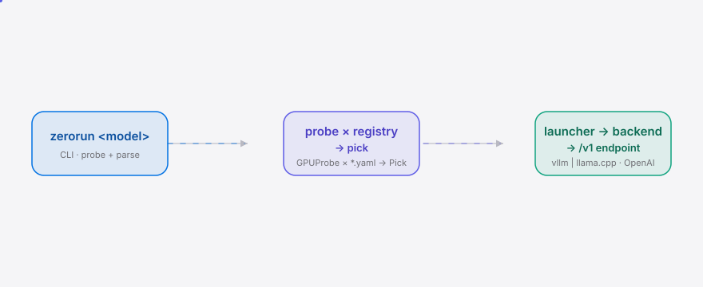
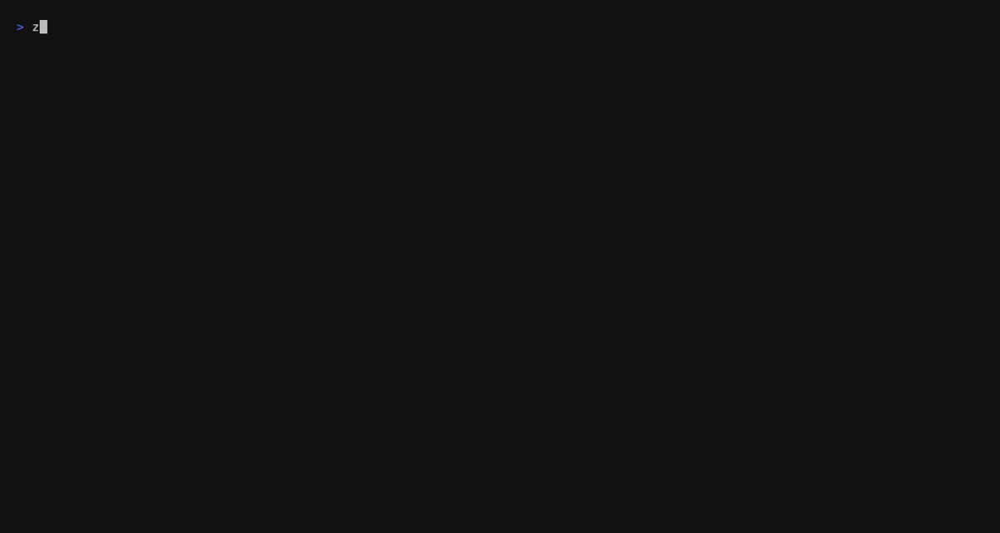

[English](./README.en.md) | **简体中文**

<div align="center">
  <picture>
    <source media="(prefers-color-scheme: dark)" srcset="./assets/hero-dark.svg">
    <source media="(prefers-color-scheme: light)" srcset="./assets/hero-light.svg">
    
  </picture>
</div>

<p align="center"><sub>ZeroRun 是一个一键启动器：探测你的 GPU，为任意前沿中文开源 MoE 自动挑选最佳 quant + backend + chat template，然后直接跑起来——把经社区验证的"每次换模型 5 小时配置"压缩成一条命令。</sub></p>

<p align="center">
  <a href="./LICENSE"></a>
  <a href="https://github.com/SuperMarioYL/zerorun/releases"></a>
  <a href="https://github.com/SuperMarioYL/zerorun/actions/workflows/ci.yml"></a>
  
  
</p>

---

> **5 小时 → 1 条命令。** 把 vLLM 那套 flag 地狱变成一条会自动选对的 `zerorun <model>`。

##  架构

<div align="center">
  <picture>
    <source media="(prefers-color-scheme: dark)" srcset="./assets/atlas-dark.svg">
    <source media="(prefers-color-scheme: light)" srcset="./assets/atlas-light.svg">
    
  </picture>
</div>

一个进程，没有微服务，没有 k8s。ZeroRun 是一个轻量 Python 编排器，把选中的后端作为子进程拉起来：

- `cli.py` — 解析 `zerorun <model> [--dry-run] [--backend X] [--quant Y] [--gpu "80:9.0"]`
- `probe.py` — pynvml 探测 VRAM / 算力 / 架构族，带 `nvidia-smi` 解析兜底
- `picker.py` — **纯函数** `(GPUProbe, ModelEntry) -> ranked Picks`，无 I/O，可单测
- `launcher.py` — 拼出后端 argv，spawn 子进程，流式输出，打印 OpenAI 兼容端点
- `registry/*.yaml` — **数据，不是代码**；社区可 PR；护城河就在这里

##  为什么

每换一个中文开源 MoE——DeepSeek V4 flash dspark、Qwen 3.6 A3B、GLM 5.2、Kimi K3——你都要重解同一道组合题：哪种 quant 格式（Q4_K_M / Q8 / NVFP4 / ternary）、哪个 backend（vLLM / llama.cpp / ExLlamaV3）、哪个 chat template，手写一遍，上游一打补丁就静默过时。r/LocalLLaMA 上有人报告"光配 vLLM 跑 deepseek v4 flash dspark 就花了 5 小时"，而换模型的频率本身在加速——各厂近乎每月一发。ZeroRun 引入的新动词是 *zero-run*：一条命令探测你的 GPU+显存，为指定模型挑出最佳 quant+backend+template，用合理默认值直接跑起来。模型发布节奏不再复利成你的时间债。

##  安装与快速开始

```bash
# 1. 一条命令安装（uv 优先；pipx / pip -e . 等价）
uv tool install zerorun
# 或本地开发：
git clone https://github.com/SuperMarioYL/zerorun && cd zerorun && uv sync

# 2. 探测你的 GPU（VRAM / 算力 / 架构族 + 哪些模型放得下）
zerorun probe

# 3. 一条命令挑配置 + 拉起后端（首跑会下载权重——是等待，不是操作）
zerorun deepseek-v4
# → 打印 OpenAI 兼容端点 http://localhost:8000/v1，任意客户端直连
```

<details><summary>没有 NVIDIA GPU？用 <code>--gpu</code> 模拟一张卡看挑选逻辑（10 秒可见结果）</summary>

```bash
# 模拟一张 80GB Hopper（H100）—— picker 会挑出 DeepSeek 的 Q8_0/llama.cpp
zerorun deepseek-v4 --dry-run --gpu "80:9.0"
# 模拟一张 24GB Ada（RTX 4090）—— 只有最小的 Qwen 3.6 A3B 放得下
zerorun --list --gpu "24:8.9"
```

`--gpu "<显存GB>:<算力>"` 让 picker 在任何机器上可演示；probe 会被标注 `(simulated)`。

</details>

##  用法

```bash
# 列出全部 hero 模型 + 在你 GPU 上的自动挑选结果
zerorun --list

# 只打印挑选出的配置（quant/backend/template/argv/endpoint），不拉起后端
zerorun deepseek-v4 --dry-run --gpu "80:9.0"

# 覆盖 picker 的选择——但 GPU 必须放得下，否则会报具体差多少
zerorun deepseek-v4 --backend vllm --quant NVFP4 --gpu "80:9.0"
zerorun kimi-k3 --backend llama.cpp --quant Q4_K_M --port 8080

# 四个 hero 模型，各自一条命令（v0.1 全部支持）
zerorun deepseek-v4   # 5 小时 → 1 命令 的那个模型
zerorun qwen-3.6      # 最小的 A3B，单卡消费级显卡就能跑
zerorun glm-5.2       # 模板陈旧性故事的来源
zerorun kimi-k3       # 最重的那个，多 backend 抉择在这里最关键
```

挑选启发式是**有据可查**的：accuracy（精度保留）为主轴，backend throughput 与 VRAM headroom 只做平局打破。`--dry-run` 会打印每一项的算式，`registry/*.yaml` 是可读的 YAML，社区可 PR——你不必盲信我的挑选。

<details><summary>挑选算式（<code>picker.score_quant</code>）</summary>

```
score = accuracy_score(format)              # 0.60–1.00，主轴
      + backend_throughput(backend, arch)   # 0.00–0.15，破平
      + vram_safety(vram, min_vram)         # 0.00–0.08，破平
```
- accuracy 排序遵循 GGUF 层级：`F16 > Q8_0 > Q6_K > Q4_K_M > NVFP4 > Q3 > Q2`；NVFP4（W4A4）排在 Q4_K_M 之下。
- vLLM 在 Hopper+ 上拿满 0.15（FA-4 / tensor-core 路径）；llama.cpp 是 0.05 的广适配分。
- 不可行的变体得负分（按"离可行还差多远"排序），仍会列出用于诊断——你会看到"差 16 GB"，而不是一个干巴巴的"跑不了"。

</details>

##  Demo

`zerorun probe` → `zerorun deepseek-v4 --dry-run --gpu "80:9.0"` → `zerorun --list` 的快乐路径（CI 在 tag 上用 vhs 重新渲染）：



##  配置——版本化模型注册表

护城河是一个 **YAML 注册表**，不是代码。每条目把今天散落在论坛帖子和维护者记忆里的东西打包成机器可读、硬件感知的配置：

```yaml
# registry/deepseek-v4.yaml —— 数据，社区可 PR；CLI 别名 = 文件名 stem
model: deepseek-v4-flash-dspark
hf_id: deepseek-ai/DeepSeek-V4-flash-dspark   # 后端自动下载权重
quants:
  - format: NVFP4          # quant 格式
    backend: vllm          # 后端
    min_vram_gb: 48        # picker 的 VRAM 下限
    compute_cap_min: 9.0   # picker 的 架构下限（可选，0=任意）
    args: ["--kv-cache-dtype", "fp8", "--tensor-parallel-size", "1"]
  - format: Q4_K_M
    backend: llama.cpp
    min_vram_gb: 32
    compute_cap_min: 7.5
    args: ["-c", "8192", "--n-gpu-layers", "999"]
chat_template_ref: deepseek-v4
staleness_pin: "deepseek-v4@2026-07"   # m3：对上游漂移告警
```

| 字段 | 类型 | 默认 | 含义 |
|---|---|---|---|
| `model` | str | — | 全名（展示用） |
| `hf_id` | str | — | Hugging Face 模型 id，后端据此自动拉权重 |
| `quants[].format` | str | — | quant 格式（NVFP4 / Q4_K_M / Q8_0 / FP8 …） |
| `quants[].backend` | str | — | `vllm` 或 `llama.cpp`（ExLlamaV3 是 m3） |
| `quants[].min_vram_gb` | float | — | picker 的 VRAM-fit 下限 |
| `quants[].compute_cap_min` | float | 0 | 算力下限；0 = 任意架构都行 |
| `quants[].args` | list[str] | `[]` | 后端 argv 的逐项 flag |
| `chat_template_ref` | str | — | chat template 引用 |
| `staleness_pin` | str | — | 版本锚（m3 漂移告警用） |

fork 自己的注册表：设 `ZERORUN_REGISTRY_DIR=/path/to/your/registry`，或 `--registry-dir`。

##  路线图

- [x] **m1 — GPU 探测 + 注册表 schema + 1 个 hero 模型**（DeepSeek V4 dspark，`probe` + `--dry-run`）
- [x] **m2 — 挑选 + 启动**（4 个 hero 模型 × 2 后端，picker 评分 + launcher 拉起后端 + 打印 OpenAI 端点）
- [ ] **m3 — 陈旧性守卫 + ExLlamaV3**（上游版本锚 + 漂移告警；第三个后端 ExLlamaV3；社区 PR 注册表流程）

v0.1 只交付 vLLM + llama.cpp 两个后端。不做 Web/TUI、不做量化本身、不做托管 SaaS——ZeroRun 只挑现成的 quant，从不开新。

## 与现有方案的区别

| 能力 | ZeroRun | [ollama](https://github.com/ollama/ollama) | [vLLM](https://github.com/vllm-project/vllm) | [llama.cpp](https://github.com/ggerganov/llama.cpp) |
|---|:---:|:---:|:---:|:---:|
| 一键启动 | ✓ | ✓ | — | — |
| 多后端自动挑选（vLLM + llama.cpp） | ✓ | — | — | — |
| 前沿 quant（NVFP4 / FP8 / ternary）及时跟进 | ✓ | 部分（滞后） | ✓ | 部分 |
| 版本化、硬件感知的模型配置注册表 | ✓ | — | — | — |
| chat-template 陈旧性告警（m3） | ✓ | — | — | — |
| 上手即用、合理默认值 | ✓ | ✓ | —（专家 gate） | —（每模型手调） |

诚实承认：ollama 在它支持的格式上做得极好——它的单后端哲学 *本身就是* 它的价值主张；多后端 auto-pick 会破坏其模型，且它没动力背起 quant 研究的维护成本。ZeroRun 是前沿中文 MoE 配置的专精层。vLLM 吞吐量更强、ollama 生态更广——ZeroRun 不和它们比性能，比的是"换模型的配置开销"。

##  License 与贡献

MIT，见 [LICENSE](./LICENSE)。面向开发者、OSS、v0.1 无任何付费功能。提 issue 或 PR 都欢迎——加一个 quant floor 或修一个 chat-template 引用只需改一行 `registry/*.yaml`，无需碰 Python。

## Share this

```
ZeroRun — 5h → 1 命令：探测你的 GPU，为前沿中文开源 MoE 自动选 quant+backend+template 并直接拉起。OSS，Python，vLLM+llama.cpp。 https://github.com/SuperMarioYL/zerorun
```

<p align="center"><sub><a href="./LICENSE">MIT</a> © 2026 SuperMarioYL</sub></p>
